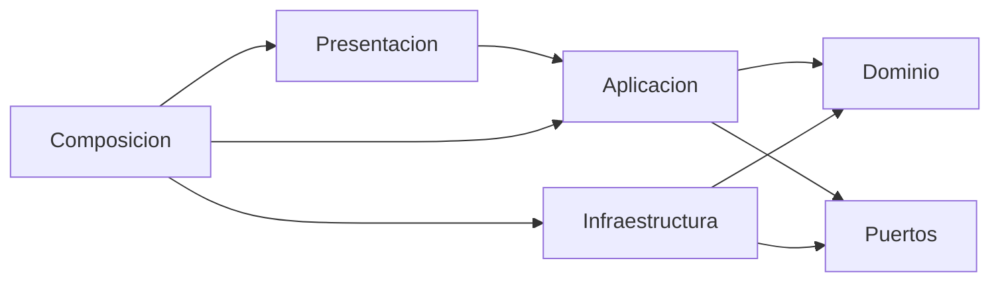

# Capas y dependencias

Cada servicio NestJS separa `domain`, `application`, `infrastructure`, `presentation` y `composition`. IA usa los mismos nombres. La regla no se cumple por el nombre de la carpeta: se cumple porque el dominio no importa frameworks y la aplicación no importa adaptadores concretos.

- Dominio: entidades, objetos de valor, políticas e invariantes. Sin NestJS, FastAPI, TypeORM, Mongoose, SQLAlchemy, HTTP, Redis, LangGraph, OpenAI ni RabbitMQ.
- Aplicación: casos de uso, transacción y puertos. Depende del dominio. No conoce controllers ni modelos ORM.
- Infraestructura: ORM, clientes, hash, broker, Qdrant y repositorios. Implementa puertos y mapea; no se devuelve el modelo ORM.
- Presentación: DTO allowlist, códigos HTTP y llamada al caso de uso. Traduce errores y no decide saldo, elegibilidad ni permiso.
- Composición: construye dependencias. No contiene reglas.

`packages/contracts` publica esquemas de eventos y errores comunes. No exporta entidades ni repositorios. Un servicio no importa el dominio de otro.

Auditoría no usa TypeORM. Su adaptador es Mongoose, según la guía oficial de MongoDB de NestJS, y el documento de infraestructura sigue separado del registro de dominio.

La fase 2 debe rechazar en compilación o lint cualquier import prohibido desde `domain`. Este documento no sustituye esa prueba.
